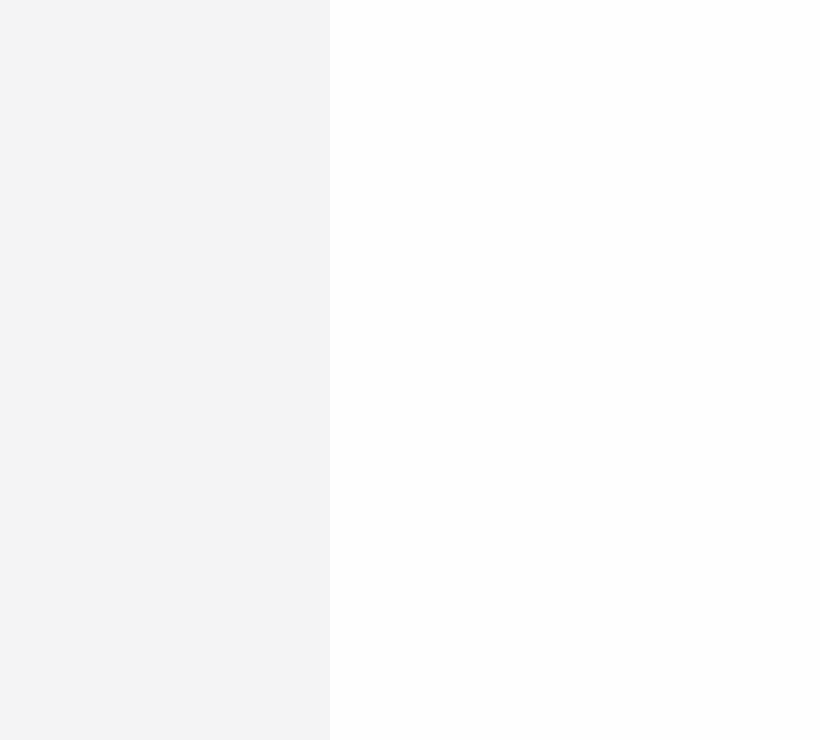
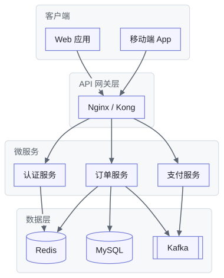
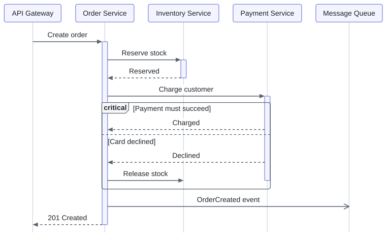

# streameraid

**Mermaid diagrams in pure Go, drawn while the model is still writing them.**

[中文说明](README.zh-CN.md)

streameraid parses, lays out and draws Mermaid diagrams without a browser, a WebView or JavaScript. In a [MyGo](https://github.com/egoist/mygo) app it draws them natively as their source streams in: what is already there stays where it is, new nodes fade in, and new edges are drawn from their source to their target.




> **Status: early, not released yet.** Flowcharts, sequence, state, class and ER diagrams, mind maps and pie charts are drawn; other kinds (Gantt, timeline, ...) show as code. There is no tagged version yet, so the `go get` and `go install` commands below will work once the first one is out; until then, clone the repository. The API may change.

## Why

Models answer with Mermaid all the time. The usual way to show it is mermaid.js in a browser: for a native Go app that means shipping or requiring Chromium, drawing to a bitmap, and laying the whole diagram out again for every chunk of the reply, so that nodes jump around while it streams.

streameraid is for apps that want none of that:

- **Pure Go.** No cgo, no Chromium, no JavaScript. The core depends only on `golang.org/x/image`.
- **Made for streaming.** The parser reads sources that are cut off anywhere. The layout follows the one before it: a node that is there does not move unless something new needs its place.
- **Native and vector.** Shapes are painted with MyGo's painter and follow the theme, light or dark. Labels are real text: they can be selected and copied.
- **Also a library and a command.** `RenderSVG` and the `streameraid` command turn Mermaid into SVG anywhere Go runs.

## In a MyGo app

MyGo's Markdown view has a hook for code blocks. Give it `mermaid.CodeBlock` and mermaid blocks show as diagrams, while they are still being written too:

```go
import (
	"github.com/egoist/mygo/ui"
	"github.com/egoist/mygo/ui/markdown"

	"github.com/momaek/streameraid/mygo/mermaid"
)

app.md.Code = map[string]func(*ui.Context, *markdown.CodeBlockView){
	"mermaid": mermaid.CodeBlock,
}
```

Kinds of diagrams that are not drawn yet show as code, as before.

`mermaid.CodeBlockWith(mermaid.Options{...})` takes options, and `mermaid.View(c, src, options)` draws a diagram outside Markdown:

| Option | What it does |
| --- | --- |
| `Streaming` | The source is still being written. `CodeBlock` sets it from the block. |
| `FontSize` | The size of labels; the theme's by default. |
| `OnNodeClick` | Called with the ID of the node the user clicks, in the kinds drawn as nodes and edges (all but sequence diagrams and pie charts). |
| `OnExport` | Receives the SVG when the user exports the diagram; it goes to the clipboard otherwise. |
| `NoToolbar` | Hides the controls that show over a diagram under the pointer. |
| `NoFit` | Lets a wide diagram scroll sideways instead of scaling it down to fit once complete. |
| `Labels` | The view's texts. `mermaid.ChineseLabels` has them in Chinese. |

What a diagram does in a MyGo app:

- **While it streams**: nothing that is there moves unless it must; new parts fade in over 240 ms; a diagram wider than the view scrolls sideways rather than shrink as it grows.
- **Once complete**: it is balanced once more, and scaled down to fit the view if it is too wide.
- **Under the pointer**: the edges of the node under the pointer stand out. Controls at the top right zoom, copy the source and export SVG.
- **Reduce Motion**: with the desktop's setting on, changes show at once.

Run the examples from the `mygo` directory:

```sh
go run ./examples/playground   # types sources out and draws them as they grow
go run ./examples/chat         # a reply streaming into the Markdown view
```

[`examples`](examples) has smaller apps, one for each way to use it: a single view, Markdown, a streaming model, clicks on nodes and export, a live editor.

## As a library

```go
import "github.com/momaek/streameraid"

svg, err := streameraid.RenderSVG(src, streameraid.Options{Dark: true})
```

`Render` also returns the statements it could not read: the rest of the diagram is still drawn.

The packages underneath can be used on their own: `flow`, `seq`, `state`, `class`, `er`, `mindmap` and `pie` parse; `layout/sugiyama`, `layout/sequence`, `layout/tree` and `layout/piechart` lay out; `render/svg` draws. State, class and ER diagrams and mind maps parse into the flowchart's model, `flow.Graph`, so they share its layout, drawing and animations; `streameraid.ParseGraph` and `LayoutGraph` pick the right ones for a kind. Layouts measure text through an interface, so that a renderer can measure with the fonts it draws with.

## As a command

```sh
go install github.com/momaek/streameraid/cmd/streameraid@latest

streameraid render diagram.mmd -o diagram.svg
streameraid render -dark -bg '#0d1117' < diagram.mmd > diagram.svg
```





## What is drawn

**Flowcharts** (`flowchart`, `graph`; TD, TB, BT, LR, RL)

- Nodes: rectangle, rounded, stadium, subroutine, cylinder, circle, double circle, flag, diamond, hexagon, parallelogram and trapezoid, and the `A@{ shape: ... }` form for those.
- Labels: quoted, with `<br/>`, wrapped when long, Markdown strings.
- Edges: `-->` `---` `-.->` `==>` `~~~` `<-->` `--o` `--x`, longer ones (`--->`), with text (`-->|text|`, `-- text -->`), chains, `&`, loops back to the same node.
- `subgraph`, nested, with `direction`; edges to a subgraph.
- `classDef`, `class`, `:::`, `style`, `linkStyle` (fill, stroke, color, width, dashes).

**Sequence diagrams** (`sequenceDiagram`)

- `participant` and `actor` with aliases, `box`, `create` and `destroy`.
- Messages: `->` `-->` `->>` `-->>` `-x` `--x` `-)` `--)` `<<->>` `<<-->>`, to oneself, with `+` and `-`.
- `activate` and `deactivate`, `Note left of`, `right of` and `over`, `autonumber`, a title.
- `loop`, `alt` / `else`, `opt`, `par` / `and`, `critical` / `option`, `break`, `rect`, nested.

**State diagrams** (`stateDiagram`, `stateDiagram-v2`)

- States, with `state "text" as S` and descriptions (`S : text`); `[*]` as start and end, in each composite state.
- `<<choice>>`, `<<fork>>`, `<<join>>`; composite states, nested, with `direction`; concurrent regions (`--`).
- Transitions with text; `note left of` and `right of`, on one line or as a block.
- `classDef`, `class`, `:::`, `style`.

**Class diagrams** (`classDiagram`)

- Classes with attributes and methods, from blocks or `A : member` lines; annotations (`<<interface>>`); generics (`List~T~`); labels (`A["text"]`).
- Relations: inheritance, composition, aggregation, association, dependency, realization, links solid and dashed, lollipops, two-sided; multiplicities at both ends (`"1" --> "*"`) and a label.
- `namespace`, `note for`, `direction`, `classDef`, `cssClass`, `:::`, `style`.

**ER diagrams** (`erDiagram`)

- Entities with attributes (type, name, keys, comment), in aligned columns; aliases (`p[Person]`).
- Relationships in crow's foot notation, symbols or words (`one or more`, `zero or one`, ...), identifying and not, with a label.

**Mind maps** (`mindmap`)

- A tree by indentation; nodes plain or as square, rounded, circle, bang, cloud and hexagon; Markdown strings; `:::` classes. Each branch has its own color. Icons are left out.

**Pie charts** (`pie`)

- Slices with labels and values, `title`, `showData`; a legend with each slice's share.

**Not drawn**

- Other kinds of diagrams (Gantt, timeline, journey, ...): they show as code.
- `click` actions and most of `%%{init}%%`.
- Sequence diagrams show participants at the top only, not again at the bottom, and ignore `links` and participant types other than `actor`.

It does not try to match mermaid.js pixel for pixel: it tries to be right and easy to read.

## How it holds still

- **Parsing.** The whole source is parsed each time, which takes microseconds. On the last line, a name that reaches the end of the source may still grow (`B`, then `Ba`, then `Bar`), so it makes no node yet: nothing appears, goes and comes back.
- **Layout.** Flowcharts are laid out in ranks, as dagre does. While a diagram streams in, the nodes of the layout before are held where they were; new ones go beside them. Sequence diagrams grow downward, and lifelines only ever move apart. Mind maps hold their nodes in place and grow at the ends of branches; a pie keeps its place, and only its slices turn.
- **Tests.** Every sample of the corpus is streamed in a character at a time, checking that no layout on the way has overlapping nodes, and measuring how much moves. The limits are part of the test suite.

On the corpus of flowcharts, following the layout before moves 5.9% of nodes per change, against 14.4% when laying out afresh; on mind maps, 1.7% against 25.3%.

## Requirements

- The core: Go 1.26 or later.
- The `mygo` module: what MyGo asks for, Go 1.27.3 or later at the moment. It is tested with MyGo v0.9.0.

## Development

```sh
go test ./...                              # the core
(cd mygo && go test ./...)                 # the MyGo renderer
go test . -run TestGolden -update          # accept changes to the SVGs in testdata/golden
```

`testdata/corpus` holds the samples: the examples of Mermaid's documentation, and diagrams written the way models write them. More real ones are welcome.

[PLAN.md](PLAN.md) (in Chinese) has the design and what is left to do.

## License

[MIT](LICENSE). The samples in `testdata/corpus/mermaid-docs` are from [Mermaid](https://github.com/mermaid-js/mermaid)'s documentation, under its MIT license.
