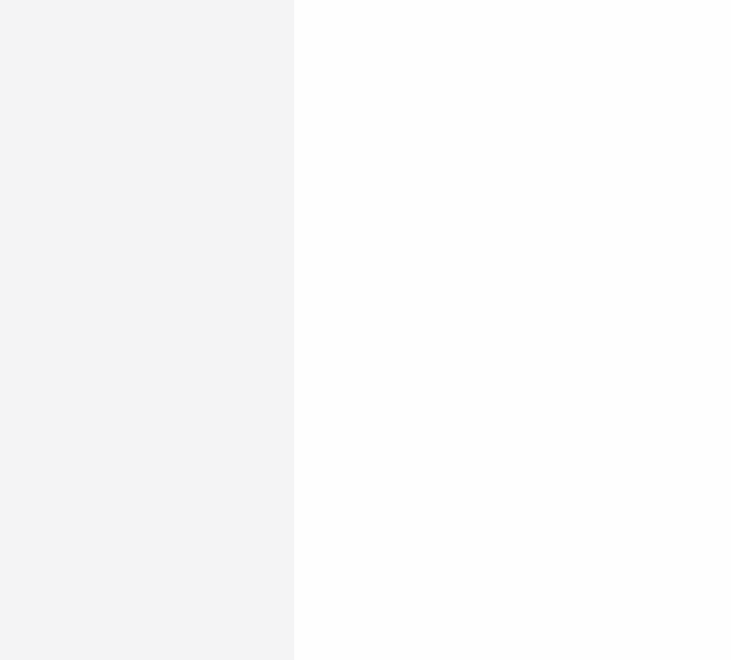
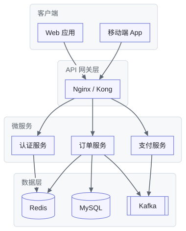
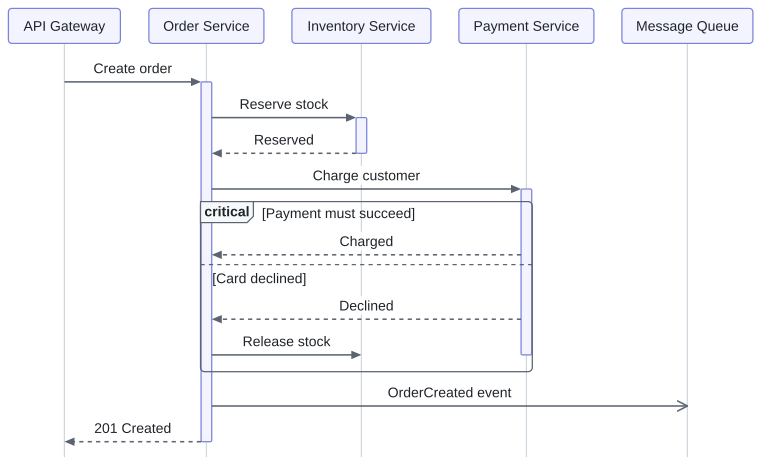

# streameraid

**纯 Go 的 Mermaid 渲染器：模型还在输出，图就已经在画了。**

[English](README.md)

streameraid 解析、布局、绘制 Mermaid 图表，不需要浏览器、WebView 或 JavaScript。在 [MyGo](https://github.com/egoist/mygo) 应用里，它随着源码流式到达原生绘制：已有的内容原地不动，新节点淡入，新连线从源点画向目标。




> **状态：早期阶段，尚未发布。** 目前能画流程图和时序图，其他类型按代码显示。还没有打版本号，下面的 `go get` 和 `go install` 命令要等第一个版本发布后才能用，在那之前请克隆仓库。API 可能变化。

## 为什么做

模型的回复里经常带 Mermaid。通常的做法是在浏览器里跑 mermaid.js：对原生 Go 应用来说，这意味着要自带或要求安装 Chromium，画出来的是位图，而且每来一段回复就要把整张图重排一遍，流式输出时节点跳来跳去。

streameraid 是给不想要这些的应用准备的：

- **纯 Go。** 不用 cgo，不用 Chromium，不用 JavaScript。核心只依赖 `golang.org/x/image`。
- **为流式而做。** 解析器能读在任何位置被截断的源码。布局会参考上一次的结果：已有的节点不动，除非新内容确实需要它让位。
- **原生矢量。** 图形用 MyGo 的画笔绘制，跟随主题和明暗模式。标签是真实的文本，可以选中复制。
- **也是库和命令行。** `RenderSVG` 和 `streameraid` 命令可以在任何能跑 Go 的地方把 Mermaid 转成 SVG。

## 在 MyGo 应用里用

MyGo 的 Markdown 组件给代码块留了钩子。把 `mermaid.CodeBlock` 交给它，mermaid 代码块就显示成图表，还在输出的时候也一样：

```go
import (
	"github.com/egoist/mygo/ui"
	"github.com/egoist/mygo/ui/markdown"

	"github.com/momaek/streameraid/mygo/mermaid"
)

app.md.Code = map[string]func(*ui.Context, *markdown.CodeBlockView){
	"mermaid": mermaid.CodeBlock,
}
```

还不能画的图表类型仍然按代码显示。

`mermaid.CodeBlockWith(mermaid.Options{...})` 可以带选项，`mermaid.View(c, src, options)` 可以在 Markdown 之外画图：

| 选项 | 作用 |
| --- | --- |
| `Streaming` | 源码还在输出。`CodeBlock` 会根据代码块是否闭合自动设置。 |
| `FontSize` | 标签字号，默认用主题的字号。 |
| `OnNodeClick` | 用户点击流程图节点时调用，参数是节点 ID。 |
| `OnExport` | 用户导出图表时收到 SVG；不设置则复制到剪贴板。 |
| `NoToolbar` | 不显示鼠标移到图上时出现的工具条。 |
| `NoFit` | 很宽的图保持原大小、横向滚动，而不是闭合后缩小到适应宽度。 |
| `Labels` | 界面文字。`mermaid.ChineseLabels` 是中文版。 |

图表在 MyGo 应用里的表现：

- **流式输出时**：已有的内容不动，除非不得不动；新内容在 240 毫秒内淡入；比视图宽的图横向滚动，不会一边长一边缩。
- **闭合之后**：再整体调整一次，太宽的话缩小到适应视图宽度。
- **鼠标悬停**：鼠标下的节点所连的边会高亮。右上角的工具条可以缩放、复制源码、导出 SVG。
- **减少动态效果**：系统开了这个设置时，变化直接到位，没有动画。

示例在 `mygo` 目录下运行：

```sh
go run ./examples/playground   # 逐字"打出"源码，同时把图画出来
go run ./examples/chat         # 一段回复流式输出到 Markdown 组件
```

[`examples`](examples) 目录里有更小的示例，每种用法一个：单个视图、Markdown、流式输出的模型、点击节点和导出、实时编辑器。

## 作为库使用

```go
import "github.com/momaek/streameraid"

svg, err := streameraid.RenderSVG(src, streameraid.Options{Dark: true})
```

`Render` 还会返回没能读懂的语句：图的其余部分照常画出。

底下的包可以单独使用：`flow` 和 `seq` 负责解析，`layout/sugiyama` 和 `layout/sequence` 负责布局，`render/svg` 负责绘制。布局通过一个接口测量文字，所以渲染器可以用自己实际绘制的字体来测量。

## 作为命令行使用

```sh
go install github.com/momaek/streameraid/cmd/streameraid@latest

streameraid render diagram.mmd -o diagram.svg
streameraid render -dark -bg '#0d1117' < diagram.mmd > diagram.svg
```





## 能画什么

**流程图**（`flowchart`、`graph`；方向 TD、TB、BT、LR、RL）

- 节点：矩形、圆角、体育场、子程序、数据库、圆、双圆、旗形、菱形、六边形、平行四边形、梯形，以及它们的 `A@{ shape: ... }` 写法。
- 标签：带引号、`<br/>` 换行、过长自动换行、Markdown 字符串。
- 连线：`-->` `---` `-.->` `==>` `~~~` `<-->` `--o` `--x`，加长的（`--->`），带文字的（`-->|text|`、`-- text -->`），链式，`&`，指向自己的自环。
- `subgraph`，可嵌套，可带 `direction`；可以连到子图本身。
- `classDef`、`class`、`:::`、`style`、`linkStyle`（填充、描边、文字颜色、线宽、虚线）。

**时序图**（`sequenceDiagram`）

- `participant` 和 `actor` 及别名，`box`，`create` 和 `destroy`。
- 消息：`->` `-->` `->>` `-->>` `-x` `--x` `-)` `--)` `<<->>` `<<-->>`，发给自己的消息，`+` 和 `-` 简写。
- `activate` 和 `deactivate`，`Note left of`、`right of`、`over`，`autonumber`，标题。
- `loop`、`alt` / `else`、`opt`、`par` / `and`、`critical` / `option`、`break`、`rect`，可嵌套。

**不画的**

- 其他类型的图（类图、状态图、ER 图、思维导图、饼图、甘特图等）：按代码显示。
- `click` 动作，以及 `%%{init}%%` 里的大部分配置。
- 时序图的参与者只在顶部画一次，底部不重复；`links` 和 `actor` 以外的参与者类型被忽略。

它不追求和 mermaid.js 像素级一致，追求的是画得对、读起来清楚。

## 怎么做到不跳动

- **解析。** 每次都把全文重新解析一遍，只要几微秒。在最后一行，一个到达源码末尾的名字可能还会变长（`B`，然后 `Ba`，然后 `Bar`），所以先不为它创建节点：不会出现"出现、消失、再出现"。
- **布局。** 流程图用分层布局，和 dagre 是一类算法。流式输出期间，上一次布局里的节点被固定在原位，新节点放在它们旁边。时序图向下生长，生命线只会互相远离。
- **测试。** 语料里的每个样例都被逐字流式喂入，检查途中每个布局都没有节点重叠，并统计移动了多少。阈值是测试的一部分。

在流程图语料上，参考上一帧时每次变化挪动 5.9% 的节点，每次从头排则是 14.4%。

## 环境要求

- 核心：Go 1.26 或更高。
- `mygo` 模块：跟随 MyGo 的要求，目前是 Go 1.27.3 或更高。用 MyGo v0.9.0 测试。

## 开发

```sh
go test ./...                              # 核心
(cd mygo && go test ./...)                 # MyGo 渲染器
go test . -run TestGolden -update          # 接受 testdata/golden 里 SVG 的变化
```

`testdata/corpus` 是样例库：Mermaid 官方文档的例子，以及按模型的写法写的图。欢迎补充真实的样例。

设计和待办事项见 [PLAN.md](PLAN.md)。

## 协议

[MIT](LICENSE)。`testdata/corpus/mermaid-docs` 里的样例来自 [Mermaid](https://github.com/mermaid-js/mermaid) 的文档，遵循其 MIT 协议。
